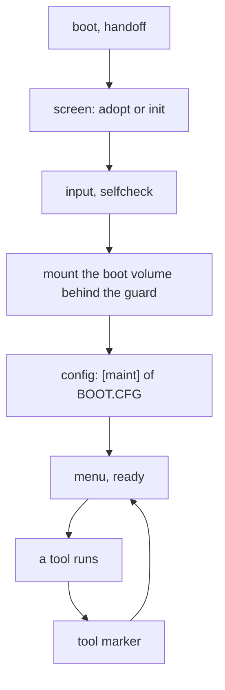

# Maintenance image

`MAINT.SYS` is the tool a person at the terminal uses when UOS cannot be used. It checks the card and its images, shows a configuration file, sets the clock chip, puts back the default user file and restarts the terminal. The sources are in `maint/`. The contract is the "Maintenance image" section of BOOT_PROTOCOL.md in RobCo-Core.

Every number on this page comes from QEMU. Nothing has been tried on real hardware.

## The image

| Field | Value |
|---|---|
| File on the card | `/ROBCO/MAINT.SYS`, built as `build/maint.sys` |
| Magic, subtype, ABI | `BOOT`, 2, 2.0 |
| Link address | `0x00400000`, the OS slot |
| Header name, version | `MAINT`, 0.1.0 |
| Stage id, marker name | 4, `maint` |
| Size | 96896 bytes from one build. It changes with the toolchain. |

## Who may use it

The image has no login. The spec makes physical presence at the terminal, with its card, the authority, as for the BIOS shell. A person who can hold a button at power-on reaches this image. A login would add nothing: that person can take the card out and change any file on another computer.

So the one tool that changes accounts, restore users, is off unless `BOOT.CFG` turns it on. A terminal on show must not hand its accounts to a passer-by. A person who can edit `BOOT.CFG` already holds the card, so the setting gives away nothing new.

## Starting it

From the boot menu, choose the `MAINT` entry. The agent's maintenance screen can start it too. Alone, a two-word image at `0x8000` jumps to `0x00400000`. `make run-maint` does this in QEMU with the card.

The image applies the trust rule. With a trusted boot info it adopts the agent's screen and clears it, as `DIAG.SYS` does. Alone, or with a block it does not trust, it starts its own 640 by 480 screen. The `handoff` marker adds `flags`, the received `boot_flags`, when the block is trusted. The image does not act on the flags.

Then it starts the SD card, mounts the boot volume behind the write guard, reads `[maint]` from `BOOT.CFG` and shows its menu.



## The menu

| Key | Effect |
|---|---|
| UP, DOWN | Move the selection |
| ENTER or SELECT | Start the selected tool |
| `1` to `6` | Start that tool |
| ESC, BACK or Ctrl-C | Stop or cancel a tool |

Keys come from the serial console, the maintenance port and the six buttons: UP 5, DOWN 6, LEFT 17, RIGHT 22, SELECT 26, BACK 27, the pins of BOARD_SUPPORT.md in RobCo-Core. The image reads no dial. The buttons do not repeat. Before the menu, the image waits up to 1 s for the GPIO backend's stuck-line guard, as the agent does. The `input` marker gives the backend state in `buttons`.

Each menu row shows the last result of its tool and a short detail. The status row under the help line shows the last result in full. A tool writes its lines in the work area under the menu, rows 14 to 29.

## Questions

A tool that writes says what it will write and asks first. ENTER, SELECT, `y` and `Y` are yes. Every other key is no: BACK, ESC, Ctrl-C and a wrong key. A release or a held key is no answer, so the SELECT that started the tool is never a yes.

## Writes

Every card access goes through a write guard in front of the card's block device, the guard of `DIAG.SYS`. By default the guard counts each write and refuses it. Check card, check images and view file run with the count at 0 and add `writes`, the count, to their marker. A count above 0 fails the tool. Restore users opens the guard only for its one `fs_write_file_atomic()` call, after a yes. Set clock writes the clock chip, not the card.

## The tools

| Tool | Reads | Writes |
|---|---|---|
| Check card | Every folder and every file of the boot volume, each file whole | Nothing |
| Check images | Every image file in `/ROBCO` | Nothing |
| View file | `/ROBCO/BOOT.CFG`, `/UOS/UOS.CFG`, `/UOS/DEVICES.CFG`, `/UOS/HOME/<user>/TERMINAL.CFG` | Nothing |
| Set clock | The clock chip at `0x68` | The time on the chip, after a yes |
| Restore users | `/UOS/SYSUAF.DEF` | `/UOS/SYSUAF.DAT`, after a yes, only with the setting on |
| Restart | Nothing | Nothing |

Results:

| Result | Meaning |
|---|---|
| OK | The tool did its job and found no fault |
| FAILED | A read, a check or a write failed, or a read-only tool tried to write |
| ABSENT | What the tool needs is not there: no card, no clock chip, no file |
| OFF | Restore users is off in `BOOT.CFG` |
| REFUSED | The person said no or cancelled. Nothing was written. |

### Not there, or could not tell

A tool reports OK only for what it measured and never hides a fault it saw, as in `DIAG.SYS`. A library call that fails gives one of two answers. "Not there" is a measured answer. "Could not tell" is a fault: the person sees it as an error with its code, the marker carries the code, and it is never a pass or a silent skip.

| Call | Not there | Could not tell |
|---|---|---|
| `fs_opendir()`, `fs_stat()`, `fs_read_file()` | `FS_ERR_NOENT` | Any other error, such as `FS_ERR_IO`, `FS_ERR_CORRUPT` or `FS_ERR_GONE` |
| `fs_readdir()` | Never: 0 is the end of the folder | Any error |
| `rtc_init()` | `RTC_ERR_ABSENT` | Any other error, such as an I2C timeout |
| `rtc_get()` before the form | Never. `RTC_ERR_HALTED` and `RTC_ERR_DATA` are a chip with no valid time. | Any other error |

Each place in the image:

| Place | Not there | Could not tell |
|---|---|---|
| `[maint]` of `BOOT.CFG` at start | `config result=missing`, the tool off | `config result=bad why=read rc`, the tool off. The status row at start says "BOOT.CFG does not read: error N. Restore users is off." A bad line says the same with its line. |
| Restore users, the setting | OFF, `why=setting` | OFF, `why=config` with `rc` or `line`. The row shows the error. |
| Restore users, the default file | ABSENT, `why=missing` | FAILED, `why=stat rc`. Nothing is written. |
| Check card, the walk | Not used: every entry the folder lists must open | A `card_error` per failure. The tool fails. |
| Check images, `/ROBCO` | FAILED, `dir=missing` | FAILED, `dir_rc` |
| View file, a fixed path | ABSENT, `why=missing` | FAILED, `why=read rc` |
| View file, `/UOS/HOME` | The note "no /UOS/HOME folder" | The note "/UOS/HOME does not read: error N." and `home=error home_rc` in `view_list`. The tool fails with `list=error list_rc`, whatever file the person viewed. |
| View file, a user's `TERMINAL.CFG` | Not offered | Offered, counted in `stat_errors`. The note says so, the tool fails, and opening it shows the error. |
| Set clock, the probe | ABSENT, `addr=0x68 rc` | FAILED, `why=probe rc` |
| Set clock, the time before the form | "not valid", `clock_form now=invalid rc` | "read error N", `clock_form now=error rc`, and `now_rc` in the tool marker |

### Check card

The tool walks the boot volume depth first from `/`. It opens every folder and reads every file to its end, in 32 KiB steps. Between steps it runs the input queue, so the keys, the screen and the maintenance port keep working on a full card. A progress line and a `progress` marker come at most every 500 ms. ESC, BACK or Ctrl-C stops it, and a stopped walk fails with `why=stopped`.

Each failure prints a `card_error` marker and a work row with its path. The walk goes on with the next entry.

| `what` | Cause |
|---|---|
| `opendir` | A folder does not open |
| `readdir` | Reading a folder failed. The rest of that folder is not checked. |
| `file` | A file does not open, a read fails, or the file gives fewer or more bytes than its size |
| `deep` | A folder more than seven levels below the root. It is not entered. |
| `long` | A path longer than 255 bytes. The path in the row is its folder. |

Then it reports the free space and the size of the volume from `fs_statvfs()`. Work row 1 gives the counts, row 2 the free space in KiB, and the failures follow from row 3. Every size is shown whole, in the marker in bytes. A card of 2 TiB gives `total_bytes=2199023255552`, not a number cut to 32 bits. The library's `%u` takes 32 bits, so the image prints 64-bit numbers with `dg_u64()` of `diag/dg_fmt.c`. The `mount` marker prints `lba` and `blocks` the same way. The tool gives OK when there is no failure and the free space reads. On a 16 MiB card filled to its last 64 KiB, the walk takes about 4 s in QEMU.

### Check images

Every entry of `/ROBCO` whose extension is `.SYS`, `.BAK` or `.IMG`, in any case, must be an image. The tool checks each one with `dg_sd_check_image()`, the check of `DIAG.SYS`'s SD test: the header first, then the whole file in RAM above the OS slot through `rimg_validate()`, the loader's own steps. Each image prints one `image` marker and a work row. Its `rc` is one of the codes in [DIAG.md](DIAG.md#sd): `ok`, `empty`, `short`, `magic`, `version`, `size`, `bounds`, `abi`, `crc`, `isdir`, `open` or `io`. A truncated image gives `size`. Other files are not listed.

OK means every image passed. A bad image fails the tool. No `/ROBCO` fails with `dir=missing`. A `/ROBCO` with no image file gives ABSENT.

### View file

The tool offers these files by name, with their paths:

| Name | Path |
|---|---|
| `BOOT.CFG` | `/ROBCO/BOOT.CFG` |
| `UOS.CFG` | `/UOS/UOS.CFG` |
| `DEVICES.CFG` | `/UOS/DEVICES.CFG` |
| `<user>/TERMINAL.CFG` | `/UOS/HOME/<user>/TERMINAL.CFG`, one per user |

UOS keeps a `TERMINAL.CFG` per user. The tool lists the folders of `/UOS/HOME` in directory order, at most 16, and offers `<user>/TERMINAL.CFG` for each folder that holds one. A 17th user folder is not listed, and the chooser says the list is cut. With no `/UOS/HOME`, or no `TERMINAL.CFG` in it, the chooser offers the three fixed files and says so. A `/UOS/HOME` that does not read is not "no folder": see [Not there, or could not tell](#not-there-or-could-not-tell). The listing only reads, behind the guard.

`fs_readdir()` already skips `.` and `..`. The library gives no other skip rule, but it gives each entry's attributes, so the tool also skips names that start with `.`, hidden and system entries, and the work names of `fs_write_file_atomic()`. A path longer than 255 characters is not offered, and the note counts it.

The chooser shows 13 rows and scrolls. UP and DOWN move, ENTER opens, ESC cancels with `why=cancel`. A file that is offered but missing gives ABSENT. Each listing prints a `view_list` marker.

The pager does not parse the file. Its rules:

- It reads at most 16384 bytes. A larger file shows its first 16384 bytes, and the header says so: `/ROBCO/BOOT.CFG: 22000 bytes, the first 16384 shown`.
- LF, CR and CRLF end a line. A tab moves to the next multiple of 8 columns. A long line wraps at 79 columns.
- Bytes `0x20` to `0x7E` show as they are. Every other byte shows as `.`, and the header counts them: `4 bytes shown as '.'`.
- An empty file shows `(empty file)` and `No lines.`
- A missing file gives ABSENT with `why=missing`. A folder of that name fails with `why=isdir`.

The page holds 14 lines. DOWN or RIGHT shows the next page, UP or LEFT the one before. ESC, BACK, Ctrl-C or ENTER closes the pager. Each page prints a `view_page` marker.

### Set clock

The tool starts I2C1 and looks for the clock chip at `0x68` with `rtc_init()`. With no chip it says "No clock chip at 0x68." and gives ABSENT. A probe that fails otherwise, such as on an I2C timeout, gives FAILED with `why=probe`.

The form starts at the chip's time, or 2000-01-01 00:00:00 when the chip's time is not valid. It has six fields: year, month, day, hour, minute and second, in UTC.

| Key | Effect |
|---|---|
| LEFT, RIGHT | Move between fields |
| UP, DOWN | Step the field and wrap inside its range |
| `0` to `9` | Type the field. The first digit starts it again. A full field moves to the next. |
| ENTER or SELECT | Check the time and ask |
| ESC, BACK or Ctrl-C | Cancel, `why=cancel` |

So the six buttons and a serial console both work. On the console, `20300615120000` then ENTER types a whole time.

At ENTER the tool checks the time with `dt_valid()`: years 2000 to 2099, the range a two-digit chip year holds, and the days of each month, leap years included. A wrong time shows "Not a valid date and time." and a `clock_invalid` marker, and the form stays.

A good time is shown in the question. A yes writes it with `rtc_set()`, reads it back with `rtc_get()` and shows both. The read back must be 0 to 2 seconds after the written time, or the tool fails with `why=readback`. Then the software clock takes the read time.

### Restore users

The tool copies `/UOS/SYSUAF.DEF`, the default user file UOS ships, over `/UOS/SYSUAF.DAT`. It is the way back in when every password is lost. It copies bytes and knows nothing of the format.

It is off unless `BOOT.CFG` has `restore_users = on` in `[maint]`. The reason is in [Who may use it](#who-may-use-it).

| Case | Result | What happens |
|---|---|---|
| The setting is not `on` | OFF, `why=setting` | The row says the setting disables it. Nothing is read or written. |
| `BOOT.CFG` did not read or parse | OFF, `why=config` with `rc` or `line` | The row shows the error. Nothing is read or written. |
| No default file, or a folder of that name | ABSENT, `why=missing` | It says so. Nothing changes. |
| An empty default file | FAILED, `why=empty` | It says so. Nothing changes. |
| A default file above 1 MiB | FAILED, `why=large` | Nothing changes |
| The stat of the default file fails with an error other than "missing" | FAILED, `why=stat` with `rc` | Nothing changes |
| The question gets a no | REFUSED, `why=no` | Nothing changes |
| A yes | OK | The copy, then "Done." |
| The read of the default or the write fails after a yes | FAILED, `why=read` or `write` | See below |

The question names both files: "Copy /UOS/SYSUAF.DEF over /UOS/SYSUAF.DAT?". After a yes the tool reads the default whole, then writes it with `fs_write_file_atomic()`, which writes a temporary file and renames it over `SYSUAF.DAT`. A power cut leaves the old or the new file whole. The image runs no recovery itself beyond what that call does. UOS reads its system files through `fs_atomic_recover()`, which finishes an interrupted restore.

Every case before the write leaves `SYSUAF.DAT` untouched: the guard refuses every write until the yes.

### Restart

The tool prints its `tool` marker, unmounts the volume so nothing waits in a buffer, prints `reboot source=tool` and resets the board with `power_reboot()`, through the PM watchdog. It asks nothing: it writes nothing.

## The setting

`[maint]` of `/ROBCO/BOOT.CFG`, by the key table of BOOT_PROTOCOL.md:

```
[maint]
restore_users = on
```

- `on` turns restore users on. `off` and any other value keep it off.
- A value other than `on` or `off` counts in `bad`. An unknown key counts in `unknown`.
- The section name, the key and the words are case-insensitive.
- `[maint]` given twice acts as one section. A key given twice takes its last value.
- A missing file, a read error or a line that does not parse leaves the tool off. A read error or a bad line also shows on the status row at start, with its code or line.
- The shipped `boot/BOOT.CFG` has no `[maint]`, so the tool is off.

## Markers

The stage name is `maint`. Each line starts with `@RC stage=maint`. The image prints `boot`, `handoff`, `config`, `ready`, then one `tool` per tool result.

| Event | Keys |
|---|---|
| `boot` | `midr soc base board_rev mem entry_mode version` |
| `handoff` | `trusted`, then `flags` when trusted |
| `screen` | `fb console path scheme cols rows` |
| `input` | `serial mini script gpio buttons` |
| `selfcheck` | `rc size` |
| `write_hook` | `name=guard`, test builds only |
| `error` | `code=io what=sd rc` or `code=io what=fat rc`, when the card or the mount fails |
| `mount` | `lba blocks` |
| `config` | `result path`, then `restore_users bad unknown`, or `why`. `result` is `ok`, `missing` or `bad`. `why` is `read` with `rc`, or `syntax` with `line`. `restore_users` is always there. |
| `ready` | The menu is up |
| `select` | `index name` |
| `tool` | `name result`, then the tool keys below |
| `progress` | `name pct`, at most one per 500 ms |
| `card_error` | `path what rc` |
| `image` | `path size rc` |
| `view_list` | `files users cut home home_rc stat_errors stat_rc long`. `home` is `ok`, `missing` or `error`. |
| `view_choose` | `sel name` |
| `view_page` | `first last lines` |
| `i2c` | `rc`, at the first use of I2C |
| `clock_form` | `now`, the chip's time, or `invalid` or `error` with `rc` |
| `clock_invalid` | `value` |
| `ask` | `what`, then `value` or `from to size` |
| `tool_drop` | `name why`, as `diag_drop` in `DIAG.SYS` |
| `reboot` | `source`: `tool` or `maint` |

`name` is `check_card`, `check_images`, `view_file`, `set_clock`, `restore_users` or `restart`. `result` is `ok`, `fail`, `absent`, `off` or `refused`.

| Tool | Keys after `result` |
|---|---|
| `check_card` | `dirs files bytes errors free_bytes total_bytes fat`, `first_path first_what` on a failure, `ms`, `why=stopped`, `writes` |
| `check_images` | `images bad`, `bad_path bad_rc` for the first bad image, `dir_rc`, `why=stopped`, `writes`. No `/ROBCO`: `images=0 dir=missing writes`. |
| `view_file` | `list=error list_rc` when the listing saw a fault, `path`, then `size shown lines binary truncated`, or `why`: `missing`, `isdir`, `read` with `rc`, `cancel`. Then `writes`. |
| `set_clock` | `chip`, `now_rc` when the time did not read, then `set read`, or `why`: `cancel`, `no`, `set`, `readback`. No chip: `addr=0x68 rc`. A failed probe: `why=probe addr=0x68 rc`. |
| `restore_users` | `why` when not OK, `from to size` after the question, `rc` on an error, `rc` or `line` with `why=config` |
| `restart` | None. `reboot` follows. |

Without a card, the tools that need it give `why=sd rc` with ABSENT for no card, or `why=mount rc` with FAILED.

## Maintenance port

The port is the mini UART: in QEMU, the second serial port. On hardware it reaches no pin.

| Command | Effect |
|---|---|
| `state` | One line: `phase trusted fb sel tool request card restore_users pending` |
| `tool <name>` | Starts one tool, through the input queue behind the keys sent before it. `err busy` while a tool runs or a request waits. |
| `dump` | The screen text |
| `key`, `char`, `text` | The library's built-in input commands |
| `reboot` | Restarts the board through the watchdog |

The test build, `build/mainttest/maint.img`, adds `wprobe`. The next read-only tool sends one write through the guard and reports its result as `probe_rc`. The guard counts and refuses it, so that tool fails with `writes=1`. It is not shipped, and a test checks that the shipped image answers `wprobe` with `err unknown command` and prints no `write_hook`.

## Shared with DIAG.SYS

- `diag/dg_sd.c`: the image name rule, the scan of `/ROBCO` and the write guard. The guard gained `pass`, set only by restore users. `DIAG.SYS` never sets it.
- `diag/dg_sdimg.c`: the check of one image file, moved out of `diag/t_sd.c`.
- `diag/dg_fmt.c`: the progress rate and `dg_u64()`, the 64-bit number formatter.
- `src/portreq.c`: the port request rule.

The screen rows, the screen set-up, the input set-up and the port commands are copied from `diag/main.c`. Sharing them would mean reshaping `DIAG.SYS`'s state.

## For the next spec update

- The view file paths: `/ROBCO/BOOT.CFG`, `/UOS/UOS.CFG`, `/UOS/DEVICES.CFG` and `/UOS/HOME/<user>/TERMINAL.CFG`, with the limit of 16 user folders. The spec names the files but gives only the first path.
- The skip rule for `/UOS/HOME` entries above, since the library gives none past `.` and `..`.

## Out of scope

Version 1 does not edit a config file, format the card, repair a file system, change one user's password or use the network.
